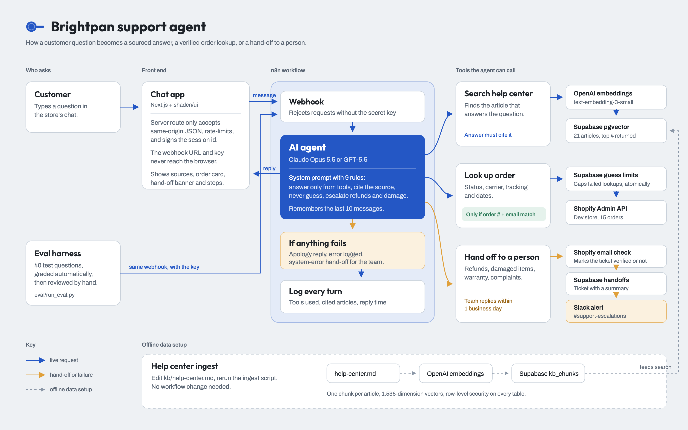

# Brightpan support agent

An AI customer support agent for an online store. It answers product, shipping and policy questions only from the store's own help center (and names the article it used), looks up orders only when the order number and the email match, and hands refunds, damaged items, warranty claims and complaints to a person with a summary.

Brightpan Kitchen Supply is a fictional store. All customers, orders and emails are demo data (`@example.com`).

## How it works



The diagram's source is `docs/architecture.html` (open it in a browser; export with any screenshot tool at 2x).

```
Chat app (Next.js)  ── POST /api/chat ──►  Next.js server route (checks origin, signs session id)
                                              │  X-Brightpan-Key
                                              ▼
                                  n8n webhook ──► AI Agent (Claude Opus 5.5 or GPT-5.5)
                                                   ├─ search_help_center → Supabase pgvector, top 4 articles
                                                   ├─ lookup_order       → Shopify Admin API, details only if email matches
                                                   └─ escalate_to_human  → Supabase `handoffs` row + Slack message
                                              │
                                              ▼
                                  every turn logged to Supabase `conversations`
```

- **Help center:** `kb/help-center.md` is split into one chunk per `## [Axx]` article, embedded with OpenAI `text-embedding-3-small` and stored in a `kb_chunks` table with pgvector.
- **Orders:** the 15 demo orders in `data/orders.json` live in a Shopify development store.
- **Agent rules:** `n8n/system_prompt.md` holds the nine rules from the spec: answer only from tools, cite the source, say "I don't have that" instead of guessing, never invent codes or prices, share orders only on a number + email match, always escalate refunds and damage reports, decline off-topic questions, and ignore instructions hidden in customer messages.
- **Failures:** if the model or any tool fails, the customer gets "Sorry, something went wrong — I've passed this to our team", the error is logged, and a `system_error` hand-off is created.

## Repository layout

| Path | What it is |
| --- | --- |
| `BUILD_SPEC.md` | The approved spec: rules, build steps, done criteria |
| `kb/`, `data/` | Help center articles and demo orders (the source data) |
| `supabase/schema.sql` | Tables `kb_chunks`, `conversations`, `handoffs`; search function; row-level security |
| `scripts/` | Python helpers: Supabase project setup, Shopify order loader, shared `.env`/HTTP helpers |
| `ingest/ingest_kb.py` | Embeds the help center into Supabase and checks retrieval |
| `n8n/` | Workflow builder (`build_workflows.py`), deployer (`deploy.py`), system prompt, Code-node JavaScript (`js/`, with tests) and the generated, importable workflow JSON (`workflows/`) |
| `eval/` | 40-question test set, eval harness, stub endpoint, results and run log |
| `web/` | Next.js + shadcn/ui chat app |

## Setup

You need Python 3.13, Node 22, Docker, and accounts for OpenAI, Anthropic, Supabase (free plan), Shopify Partners (a development store) and optionally Slack.

1. **Secrets.** `cp .env.example .env` and fill in the API keys. `.env` is git-ignored; scripts read it directly and never print values.
2. **Python environment.** `uv venv .venv && uv pip install -r requirements.txt` (only `certifi`; everything else is standard library). Run scripts with `.venv/bin/python`.
3. **Supabase.** `.venv/bin/python scripts/supabase_setup.py` creates the `brightpan-demo` project, stores its URL and service key in `.env`, and applies `supabase/schema.sql`.
4. **Help center.** `.venv/bin/python ingest/ingest_kb.py` embeds the 21 articles and prints whether each test question's article is retrieved in the top 4.
5. **Shopify.** In the Shopify Dev Dashboard, create a development store and an app with the `read_orders` and `write_orders` scopes, install it, and put the store subdomain, client ID and client secret in `.env`. Then `.venv/bin/python scripts/load_orders_shopify.py` creates the 15 orders (safe to rerun).
6. **n8n.** `./n8n/start.sh` runs n8n 2.43.7 in Docker on `localhost:5678`. In the browser, create the owner account, then Settings → n8n API → create an API key and put it in `.env` as `N8N_API_KEY`. Then `.venv/bin/python n8n/deploy.py` creates the n8n credentials from `.env`, generates the webhook key, and imports and activates the five workflows.
7. **Chat app.** `cd web && cp .env.example .env.local` (deploy.py fills in `N8N_WEBHOOK_SECRET`), `npm install`, `npm run dev`, then open http://127.0.0.1:3100.

## Changing the help center

Edit `kb/help-center.md`, keeping one `## [Axx] Title` heading per article, then rerun `.venv/bin/python ingest/ingest_kb.py`. Articles are upserted by id and removed articles are deleted, so the agent uses the new text on its next search. No workflow change is needed. The article title is what the agent cites, so keep titles short and clear.

## Evaluation

```
.venv/bin/python eval/run_eval.py --endpoint http://localhost:5678/webhook/brightpan-chat --label claude --out eval/results-claude.csv --log
```

Each of the 40 questions in `eval/testset.csv` runs as a fresh session with the date frozen to 2026-10-18. Grading follows the spec:

- **Policy and order questions** pass when every required phrase appears and the right article was cited (or the order lookup ran).
- **Refusals** pass when the agent declines without escalating and returns no order data.
- **Escalations** pass when a hand-off was actually saved.

Results go to a CSV with a `manual_verdict` column for human review, and each run's summary is appended to `eval/results-log.md`. Unit tests: `python3 -m unittest eval/test_run_eval.py` and `node --test n8n/js/test.mjs`.

### Results

Both models answered the same 40 questions on the final code, and every answer was reviewed by hand:

| | GPT-5.5 | Claude Opus 5.5 |
| --- | --- | --- |
| Answered correctly (policy + order lookups) | 25/25 | 24/25 |
| Correctly declined questions the help center doesn't cover | 10/10 | 10/10 |
| Escalations routed to a person | 5/5 | 5/5 |
| Median reply | 11.05 s | 8.72 s |

Claude's one miss (Q25) was a network error during the order lookup, answered with the error-branch apology. `eval/results.csv` holds the GPT-5.5 run; every run, including earlier and invalid ones, is in [`eval/results-log.md`](eval/results-log.md), and the reviewed sheet is `eval/answer-review.xlsx`.

## Security notes

- Secrets live only in `.env`, `web/.env.local` and n8n's encrypted credential store. The workflow JSON in the repo contains placeholders, not keys.
- n8n and the chat app listen on `127.0.0.1` only. The webhooks require an `X-Brightpan-Key` header that only the chat app's server route and the eval harness hold.
- The chat route only accepts same-origin JSON. It maps the browser's session id to a keyed hash before it reaches n8n, so a session id seen in logs can't be used to continue someone else's conversation.
- Order details are returned only when the order number and email match. A wrong email and an unknown order get the same reply, so the agent never confirms that an order exists.
- Failed lookups are capped per conversation (3 per 15 minutes) and per order number and per email (5 per hour each). The counting happens in one Postgres function that locks the keys and reserves the attempt in a single transaction, so parallel requests can't slip past the cap. Matched lookups don't count.
- A global counter of failed lookups never blocks anyone, so junk traffic can't lock every customer out. When it passes 200 failures in an hour, the limits tighten to 1 failure per conversation and 2 per order or email until the rate drops. A production system would add a one-time code or CAPTCHA at that point. To check the counter: `select count(*) from lookup_attempts where key = 'g' and failed and at > now() - interval '1 hour';`
- The chat route limits each client to 30 messages per 5 minutes. It only trusts `X-Forwarded-For` when `TRUSTED_PROXY_HOPS` says a proxy you run sets it; otherwise all requests share one bucket.
- Hand-offs record whether the customer's email matched the order. Slack alerts use Block Kit: the customer's email and summary are sent as plain text, so they can't create mentions, links or fake verification lines.
- The workflows that handle the Shopify access token store no execution data in n8n.

## Known limits and deviations from the spec

- **No temperature 0.** Claude Opus 5.5 and GPT-5.5 both reject `temperature: 0`, so the agent runs with the providers' defaults (Claude effort `low`, GPT-5.5 reasoning effort `low`). Answers can vary slightly between runs.
- **Shopify scopes.** The app only has `read_orders` and `write_orders`. A native Shopify fulfillment needs a location (`read_locations`), so carrier, tracking number, ship and delivery dates and per-item status are stored as order attributes.
- **Chat app.** The spec asked for a single HTML page; this is a Next.js + shadcn/ui app instead, at the owner's request.
- **Grading is literal.** A correct answer worded differently from the test set (for example "wash by hand" for "hand wash") fails the automatic check. The manual verdict in the results CSV is final.
- **Memory.** Conversation memory is kept in n8n's process memory (last 10 messages per session) and is lost when n8n restarts.
- **Local only.** This is a local demo: there is no user login or production hosting. The chat rate limit lives in the Next.js process memory, so it resets on restart and isn't shared between servers.
- **Lockout trade-off.** Because the order number and email are the only proof of ownership, an order or email that collects 5 failed guesses in an hour is locked for everyone, including its real owner, until the hour passes. The agent then offers to connect the customer to a person. Removing this trade-off needs a second factor, such as a one-time code emailed to the customer.
- **Lookup limit and the eval.** Each eval run makes two deliberately failed lookups: order 1002 with a wrong email (Q31), and sam.reed@example.com with an unknown order (Q32). After five runs within an hour, those keys are locked, and the matching lookups (Q20, Q23) fail until the hour passes.
